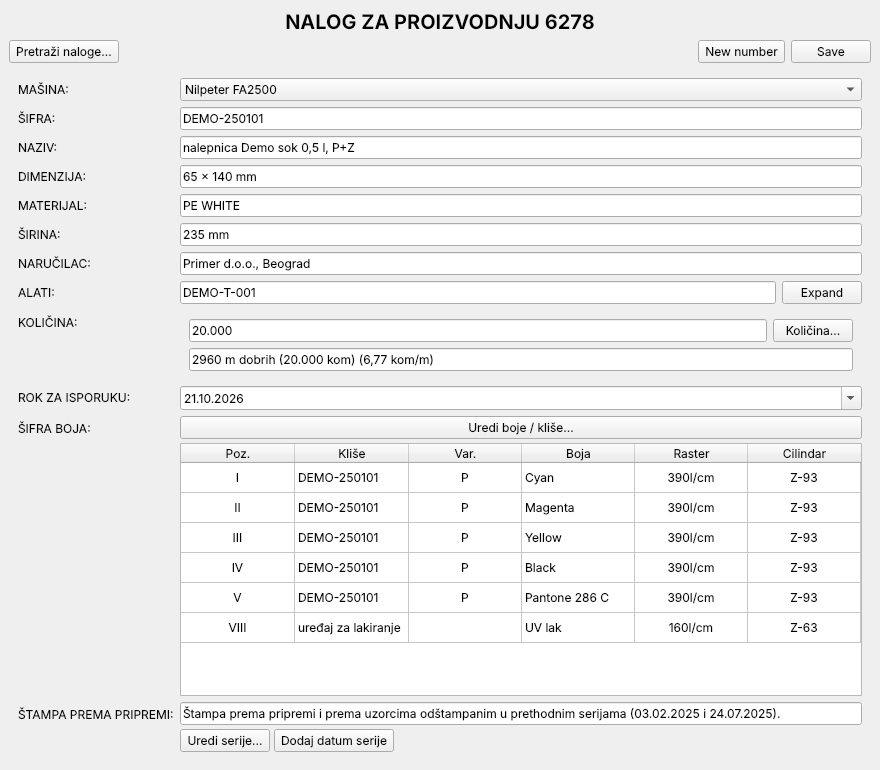
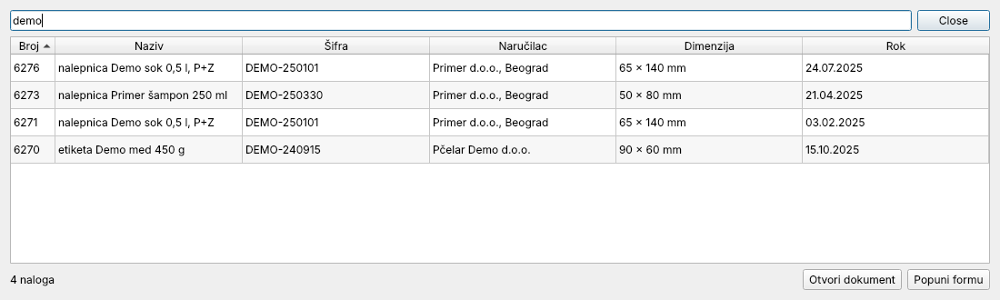
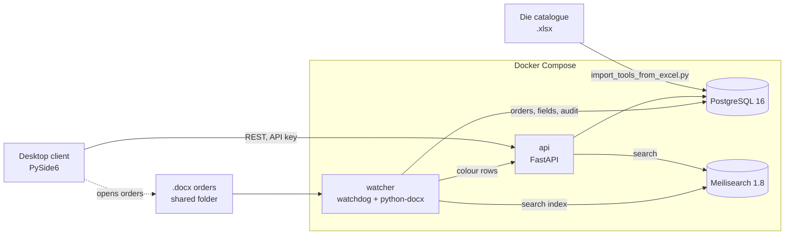

# Flexo Order Automation

A document management system for production orders at a flexographic
label printing company. Orders are written in Word; this system numbers
and files them, extracts their contents into a database, makes them
searchable, and gives staff a desktop form for preparing new orders from
the product and die catalogues.



*All data in the screenshots is fictional.*

## What it does

- **Watches a shared folder** for `.docx` production orders. A new order
  keeps the number in its header or gets the next free one, and is filed as
  `YYYY/MM/DD/<number> - <product>.docx`. Renamed or moved orders keep
  their number.
- **Parses each order** into fields: press, product code, name, size,
  material, web width, customer, quantity, delivery date, die, colour
  stations and notes. Orders with missing fields are flagged for review,
  and every parse is recorded in an audit table.
- **Stores** everything in PostgreSQL and **indexes** it in Meilisearch,
  rebuilding the index from the database on start-up.
- **Desktop client** (PySide6) for preparing an order: reserves the next
  number, autofills from the product catalogue by product code, searches
  the die catalogue, calculates metres of material from the ordered
  quantity and die layout, edits colour/plate stations, tracks
  production-run dates per product, and searches past orders to open the
  Word file or reuse it for a repeat job.



## Architecture



When a `.docx` appears or changes, the watcher:

1. waits until the file stops growing (Word saves and copies arrive in
   pieces);
2. takes the order number from the header line
   `NALOG ZA PROIZVODNJU <n>` or the file name. A known order is updated in
   place; a new one gets the number, or the next value of a Postgres
   sequence if the number is missing, already taken or implausible (such as
   a date);
3. for a new order, writes the number into the document header and moves
   the file into the dated folder;
4. saves the parsed fields, full text, colour rows and parse status, and
   updates the search index.

The API, watcher, Postgres and Meilisearch run in Docker Compose, with
published ports bound to localhost only. The desktop client and the Excel
import run on the host.

## Tech stack

Python 3.11 · FastAPI · SQLAlchemy Core · PostgreSQL 16 · Meilisearch ·
watchdog · python-docx · PySide6 · pandas / openpyxl · Docker Compose ·
pytest

## Project layout

```
server/
  app.py                    FastAPI app, API-key check, number reservation
  routes_*.py               lookups, saving orders, colours, run dates, search
  watcher_v2_1.py           folder watcher and .docx order parser
  schema*.sql               database schema (see Setup)
  seed_demo.sql             optional fictional customer and product
  requirements.txt          API and watcher dependencies (Docker image)
client/
  gui_production_order.py   production-order form, the main desktop app
  formatting.py             Serbian number formats, cylinder notation
  gui_main.py               early prototype: 90×60 mm label preview and print
import_tools_from_excel.py  loads the die catalogue from Excel
schema_watcher_v2_1.sql     parse-status and audit tables used by the watcher
tests/                      pytest suite
requirements.txt            desktop client and Excel import (host)
```

## API

Every endpoint requires an `x-api-key` header. With the stack running,
interactive docs are at <http://localhost:8000/docs>.

| Method | Path | Purpose |
|---|---|---|
| GET | `/ping` | Connection check |
| POST | `/documents/reserve-number` | Reserve the next order number |
| POST | `/documents/finalize` | Save an order's fields from the form |
| POST | `/documents/colors/save` | Replace an order's colour stations |
| GET | `/documents/colors/{doc_number}` | An order's colour stations |
| GET | `/documents/search?q=` | Search orders (Meilisearch) |
| GET | `/lookup/{machines,customers,materials,products,tools}?q=` | Autocomplete lookups |
| GET, POST | `/series` | Production-run dates for a product code |
| DELETE | `/series/{id}` | Remove a run date |

## Setup

You need Docker with Compose, and Python 3.10 or newer for the desktop
client.

### 1. Configure

```bash
cp .env.example .env
```

Fill in `.env`:

- `API_KEY`: any long random string, e.g. from `openssl rand -hex 32`
- `MEILI_MASTER_KEY`: at least 16 bytes; Meilisearch refuses to start in
  production mode with a shorter key
- `PG_DB`, `PG_USER`, `PG_PASS`: database name and credentials
- `DOCS_DIR`: absolute path of the orders folder. The watcher files orders
  there and the desktop client opens them from it.
- `HOST_UID`, `HOST_GID`: output of `id -u` and `id -g`, so filed orders
  stay owned by you
- `STANCNA_PREFIXES` (optional): your die-code prefixes, comma-separated.
  The watcher then reads only ALATI codes that start with one of them, with
  or without hyphens. Without it, it takes any code shaped like
  `ABC25-02-12345`.

### 2. Create the database

```bash
docker compose up -d db
for f in server/schema.sql server/schema_lookup.sql server/schema_kolicina.sql \
         server/schema_doc_colors.sql server/schema_series.sql \
         server/schema_tools.sql schema_watcher_v2_1.sql; do
  docker compose exec -T db sh -c 'psql -v ON_ERROR_STOP=1 -U "$POSTGRES_USER" -d "$POSTGRES_DB"' < "$f"
done
```

Run the files in this order. They can be run again safely. On the very
first start Postgres needs a few seconds to initialise; if `psql` can't
connect yet, wait and rerun.

To try the form on a fresh install, you can also load a fictional customer
and product, so that ŠIFRA `DEMO-250101` autofills the form. Leave this out
on a real database:

```bash
docker compose exec -T db sh -c 'psql -v ON_ERROR_STOP=1 -U "$POSTGRES_USER" -d "$POSTGRES_DB"' < server/seed_demo.sql
```

### 3. Start the services

```bash
make start     # docker compose up -d
make status    # container status
make watcher   # follow the watcher log
```

Copy a `.docx` order into `DOCS_DIR` and it appears in the watcher log
within a few seconds. On a fresh install the watcher logs an
`index_not_found` error at start-up and `/documents/search` returns 503
until the first order is processed; this is harmless, as the search index
is created with the first order.

After changing `server/requirements.txt`, rebuild and restart with
`docker compose up -d --build`.

### 4. Desktop client

```bash
python3 -m venv .venv
. .venv/bin/activate
pip install -r requirements.txt
python client/gui_production_order.py
```

The client reads `SERVER_HOST`, `SERVER_PORT`, `API_KEY` and `DOCS_DIR`
from `.env`. (`make gui` starts `gui_main.py`, the earlier label-printing
prototype.)

### 5. Import the die catalogue

Put the workbook at `stancne/Kopija Dimenzije štancni (002).xlsx` (sheets
`STANDARDNI OBLIK` and `SPEC. OBLIK`), then, in the virtual environment:

```bash
python import_tools_from_excel.py --dry-run   # check the layout, write nothing
python import_tools_from_excel.py             # replace those sheets' rows in the tools table
```

The import connects to Postgres on `localhost:PG_PORT` with the
credentials from `.env`, and aborts without writing if a column header is
not where it expects.

## Tests

```bash
pip install -r requirements-dev.txt
pytest
```

The tests cover the watcher's order parser, using synthetic `.docx` files
built on the fly (no database or search server needed), and the number
formatting shared by the desktop client and the watcher.

## Domain terms

Orders and field names are in Serbian.

| Term | Meaning |
|---|---|
| nalog (za proizvodnju) | production order |
| šifra / naziv | product code / product name |
| naručilac | customer |
| mašina | printing press |
| širina | web (material) width |
| količina; kom; m dobrih | quantity; pieces; metres of good material |
| štancna, alati | cutting die, tooling |
| obim cilindra; broj zuba (Z-93) | die cylinder circumference; number of teeth |
| raspored (3 x 2) | labels per die repeat, along × across the web |
| šifra boja; kliše; raster | colour stations; printing plate; anilox screen (lines/cm) |
| rok za isporuku | delivery date |
| serija | production run |
